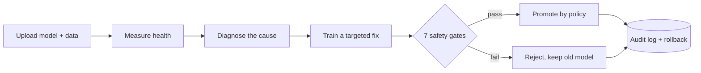

# Project Context

**AI Model Health Monitoring & Automated Maintenance System**
Status as of 2026-09-29: working prototype, single developer, college project. Some work is still uncommitted (see "Current progress").

## What it is (in one paragraph)

Machine learning models get worse after they go live, because real-world data changes. This platform watches each model, works out *why* it got worse, trains a targeted fix, checks the fix through 7 safety tests, and only then puts it live. Every step is logged and any change can be undone in one click.

## The core idea



Two rules shape everything:
1. **No blind retraining.** A fix is only tried when a diagnosis says what is wrong.
2. **No unsafe deploys.** A new model must pass all 7 gates. The default policy still asks a human to approve.

## Tech stack

| Layer | Choice |
|---|---|
| Frontend | React + Vite (single page app) |
| Backend | Python, FastAPI, SQLAlchemy |
| Database | SQLite (`model_health.db`) |
| File storage | Local folder, files named by SHA-256 hash |
| ML support | scikit-learn, XGBoost, LightGBM, CatBoost |
| Tasks supported | Binary, multiclass, regression (ranking = example only) |

## Key terms

- **Monitoring Unit** – one model plus its own data, thresholds, versions and logs. Units never affect each other.
- **Champion / Challenger** – the live model / a candidate waiting to replace it.
- **Drift** – incoming data or predictions no longer look like the training data.
- **5 health pillars** – performance, feature drift, prediction drift, schema, data quality.
- **Promotion modes** – `AUTO` (deploy if gates pass), `ASSISTED` (default, human approves), `MANUAL` (advice only).

## Current progress

**Done and working**
- Fleet dashboard, model detail, health, alerts, diagnosis, candidates, versions, audit log, inference sandbox, guided demo (frontend).
- Model intake with SHA-256 storage, size limit, extension whitelist, path protection.
- Health engine (5 pillars), diagnosis + strategy selector, refinement, 7 safety gates, promotion modes, rollback.
- Model adapters: sklearn, XGBoost, LightGBM, CatBoost. Task adapters: binary, multiclass, regression, ranking (Precision@K example).
- 27 test scripts in `scripts/test_*.py` (plain scripts, README reports all passing).

**Uncommitted changes in the working tree** (git shows these as modified/new)
- New: `sandbox.py` (first-load check of new model files in a child process), `catboost_adapter.py`, `lightgbm_adapter.py`, `tasks/ranking.py`, `scripts/export_research_dataset.py`.
- Changed: intake, diagnosis, refinement, SHAP, database, main API, security docs, alerts and model-setup screens.
- Deleted: `IntakeView.jsx` (intake now lives inside `ModelSetupView.jsx`).

**Known gaps** (the honest list)
- No user accounts or roles. One shared API key; the frontend does not send it; audit "actor" is just `SYSTEM` or `USER`.
- Rate limiting is in memory, per IP, single server only.
- Tests are not a `pytest` suite and share the dev database.
- Model files (pickle/joblib) can run code when loaded. The child-process check limits damage but is not a real sandbox.
- SQLite and local disk limit this to one server.

## Document map

| Doc | Purpose |
|---|---|
| [docs/PRD.md](docs/PRD.md) | What we build and why |
| [docs/TRD.md](docs/TRD.md) | How it is built |
| [docs/SECURITY_ACCESS.md](docs/SECURITY_ACCESS.md) | Threats, controls, who can do what |
| [docs/FRD.md](docs/FRD.md) | Screens and UI behaviour |
| [docs/APP_WORKFLOW.md](docs/APP_WORKFLOW.md) | How the app runs step by step |
| [docs/TICKETS.md](docs/TICKETS.md) | Feature tickets (built and planned) |

Older, longer references: [ARCHITECTURE.md](ARCHITECTURE.md), [docs/SECURITY.md](docs/SECURITY.md), [docs/DRIFT.md](docs/DRIFT.md), and the audit/roadmap file in the repo root.

## Run it

```bash
uvicorn backend.app.main:app --port 8000 --reload
cd frontend && npm run dev
```
