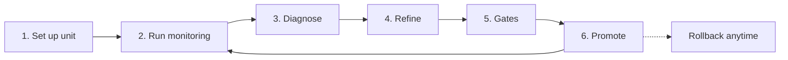
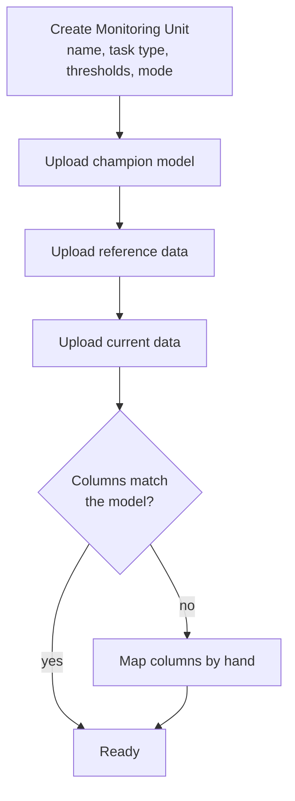
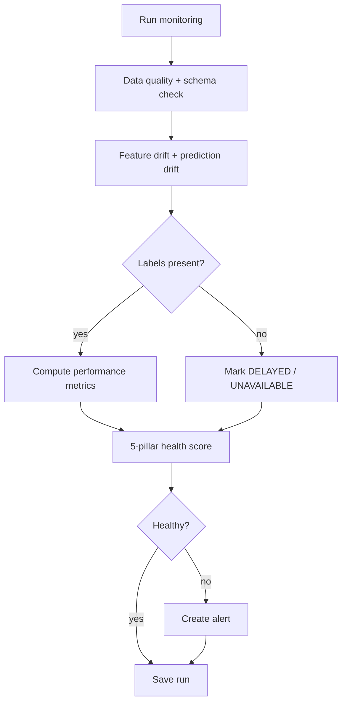
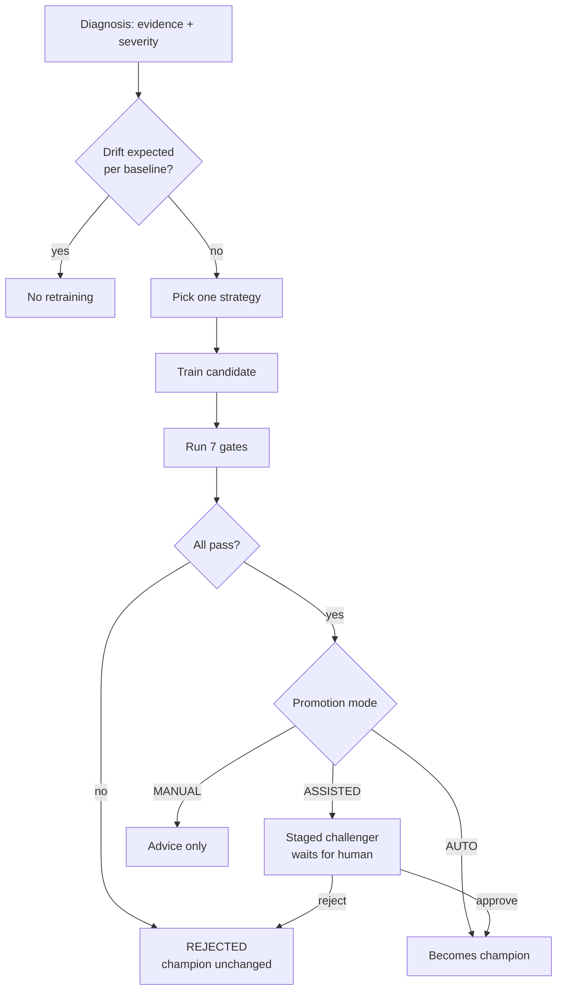
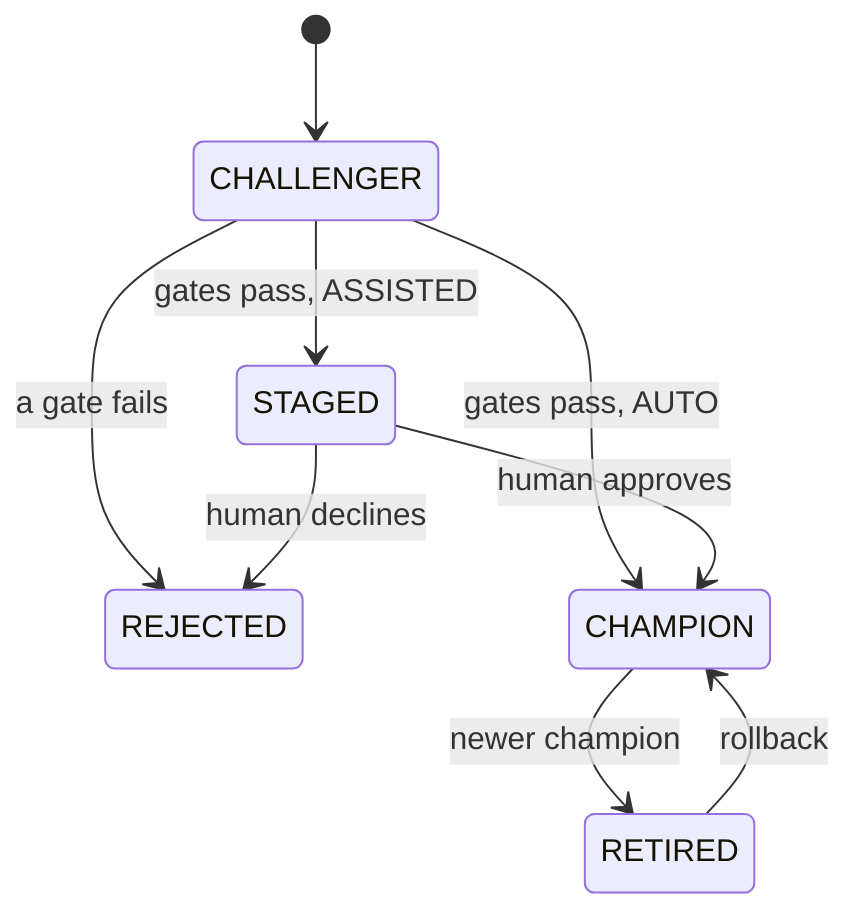
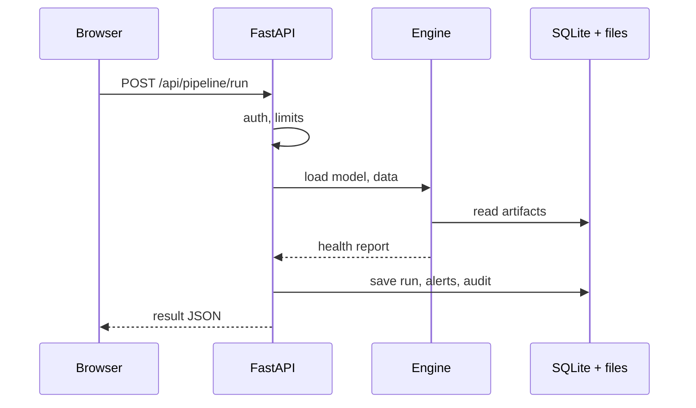

# App Workflow Document (Draft)

## 1. Big picture

## 2. Set up a unit

## 3. One monitoring run

## 4. Diagnose and refine

## 5. Candidate life cycle

## 6. Request path (technical)

## 7. Rollback

Versions tab → pick an older version → confirm → active pointer switches for that unit only → audit event `ROLLBACK`. No files are deleted or copied.
