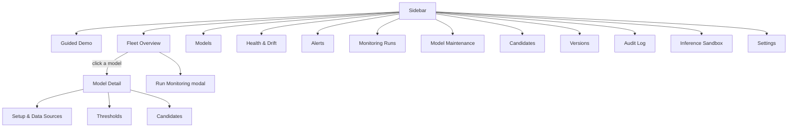
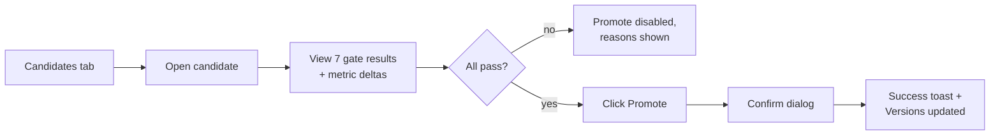

# Front End Requirement Document (Draft)

React + Vite single page app. Dark theme. Styles in `index.css`. All backend calls go through `frontend/src/api.js`. Navigation is a sidebar (`Sidebar.jsx`) plus top bar (`Header.jsx`); `App.jsx` holds the selected tab and unit.

## 1. Screen map

## 2. Screens

| Screen | File | User can |
|---|---|---|
| Fleet Overview | `FleetDashboardView` | See all models with health cards; create a unit; start a run |
| Model Detail | `ModelDetailView` | See 5 pillar meters, candidates, thresholds, log |
| Setup & Data | `ModelSetupView` | Upload champion, baseline, datasets; check schema; map columns by hand |
| Health & Drift | `HealthView` | Read metrics, drift table, gauges |
| Alerts | `AlertsView` | Filter, acknowledge, resolve |
| Monitoring Runs | `PipelineView`, `RunMonitoringModal` | Step-by-step run with live status |
| Model Maintenance | `DiagnosisView` | Plain-English cause, feature-importance plots, suggested fix |
| Candidates | `RefinementView` | Start refinement; see each gate pass/fail |
| Versions | `VersionsView` | See history; roll back |
| Audit Log | `AuditLogView` | Read who/what/when |
| Inference Sandbox | `InferenceView` | Try predictions by hand |
| Settings | `SettingsView` | Change preferences |
| Guided Demo | `GuidedDemoView` | Follow a scripted end-to-end tour |

Note: `IntakeView` was deleted (uncommitted); intake is now part of `ModelSetupView`.

## 3. UI rules

1. **Status colours:** Healthy = green, Warning = amber, Critical = red, Unknown/Delayed = grey. Never colour alone; always add a label.
2. **Plain language first:** each finding shows a short sentence, technical numbers beneath.
3. **Risky actions** (promote, rollback, delete, reset) need a confirm step and show what will change.
4. **Every screen** needs loading, empty, and error states. Errors show the server's safe message.
5. **Unit context:** the selected model is always visible in the header.
6. **Missing labels:** show "Labels delayed/unavailable", never a made-up score.
7. **Uploads:** show allowed types and the 50 MB limit before upload; show progress.
8. **Alerts badge** in the sidebar shows open count.
9. **Responsive:** usable at laptop width; tables scroll, not overflow the page.
10. **Accessibility:** keyboard reachable buttons, visible focus, text contrast on dark theme.

## 4. Key screen flow: promote a candidate

## 5. Front end gaps

- Send the API token from `api.js`.
- Hide or disable actions by role once roles exist.
- The largest components (`ModelSetupView` ~1900 lines, `FleetDashboardView`, `GuidedDemoView`) should be split.
- No automated front end tests yet.
