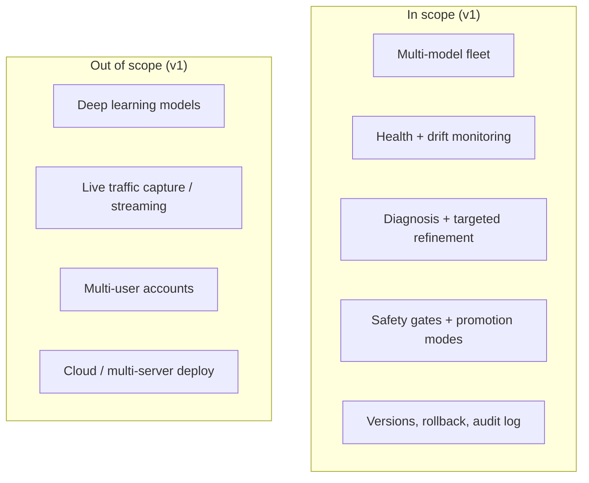
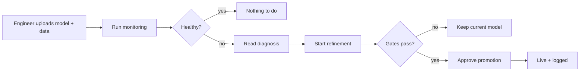

# Product Requirements Document (Draft)

## 1. Problem

Models in production slowly get worse. Teams find out late, guess the cause, retrain everything on a schedule, and sometimes ship a model that is worse than the old one.

## 2. Goal

Give a small ML team one place to **watch** models, **understand** why they degrade, **fix** them safely, and **undo** any change.

**Success looks like**
- A health problem is flagged within one monitoring run.
- Every alert comes with a plain-English cause and a suggested fix.
- No candidate reaches production without passing all 7 gates.
- Any version can be restored in one click.

## 3. Users

| User | Wants |
|---|---|
| ML engineer | Register models, run checks, review candidates |
| Ops / on-call | See fleet health and alerts at a glance |
| Reviewer / manager | Approve promotions, read the audit trail |

## 4. Scope

## 5. Requirements

| ID | Requirement | Priority | Status |
|---|---|---|---|
| R1 | Register many models, each isolated | Must | Done |
| R2 | Upload models (sklearn, XGBoost, LightGBM, CatBoost) and datasets | Must | Done |
| R3 | Health score from 5 pillars; honest "labels unavailable" state | Must | Done |
| R4 | Tell expected drift (approved baseline) from unexpected drift | Must | Done |
| R5 | Diagnose cause; pick one targeted fix | Must | Done |
| R6 | 7 safety gates before any promotion | Must | Done |
| R7 | Modes: AUTO, ASSISTED (default), MANUAL | Must | Done |
| R8 | Atomic rollback; full audit log | Must | Done |
| R9 | Alerts with acknowledge / resolve | Should | Done |
| R10 | Regression, multiclass, binary tasks | Should | Done |
| R11 | Ranking metrics | Could | Example only |
| R12 | User accounts and roles | Should | Not started |
| R13 | Research data export (CSV) | Could | Script done, uncommitted |

## 6. Main user story

## 7. Risks

| Risk | Answer |
|---|---|
| Malicious model file runs code | Extension whitelist, hash check, child-process first load (see Security doc) |
| Bad model auto-deployed | ASSISTED by default; 7 gates; rollback |
| Noisy alerts | Expected-drift baselines |
| Outgrowing SQLite | Out of scope for v1 |
