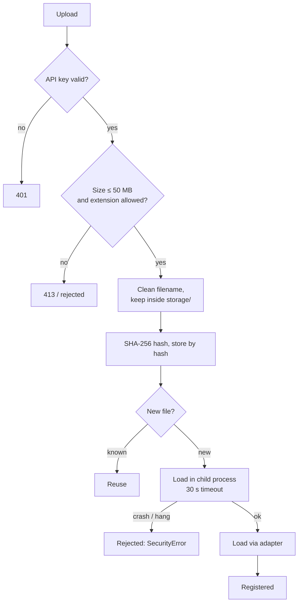
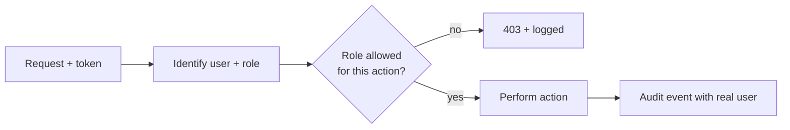

# Security & Access Document (Draft)

## 1. Main risk

Model files (`.pkl`, `.joblib`) can run code when loaded. Anyone who can upload a model can, in the worst case, run code on the server. Most controls below exist for this.

## 2. Defence layers for an uploaded model

**Honest limit:** the child process has the same OS rights as the server. It contains crashes and hangs; it does not stop malicious code. In production, accept only signed models from a trusted pipeline.

## 3. Controls

| Control | Detail |
|---|---|
| API key | If `MODEL_HEALTH_API_KEY` is set: `X-API-Key` or `Authorization: Bearer` required |
| Extension whitelist | Models: `.pkl .joblib .json .onnx .bin`. Data: `.csv .parquet .json` |
| Size limit | 50 MB default |
| Rate limits | Intake 30/min, refine 10/min, per IP |
| Path safety | Strips `../`, absolute paths, null bytes |
| Hash check | Verified before every reload |
| CORS | Fixed list of local origins, no wildcard |
| Errors | Safe messages only |
| Unit isolation | Data, versions and logs scoped per unit |
| Safe default | New units use ASSISTED mode |
| History | Old champions never deleted; audit log kept |

## 4. Access model

**Today:** one shared key gives full access. Everyone is "USER" in the audit log. The frontend does not send a key, so auth is effectively off when used from the UI.

**Proposed roles**

| Action | Viewer | Engineer | Approver | Admin |
|---|:-:|:-:|:-:|:-:|
| View dashboards, alerts, audit | ✅ | ✅ | ✅ | ✅ |
| Run monitoring, diagnosis | – | ✅ | ✅ | ✅ |
| Upload models / data | – | ✅ | – | ✅ |
| Start refinement | – | ✅ | ✅ | ✅ |
| Promote / roll back | – | – | ✅ | ✅ |
| Change thresholds, promotion mode | – | – | – | ✅ |
| Delete datasets, reset demo | – | – | – | ✅ |

## 5. Gaps to close (by priority)

1. Real users, roles, and actor names in the audit log.
2. Make the frontend send the token; block AUTO mode for non-admins.
3. Lock down `/api/demo/*` routes outside demo mode.
4. Shared rate-limit store if more than one server.
5. Signed model artifacts; OS-level sandbox (container, no network).
6. Secrets and DB backup guidance.
