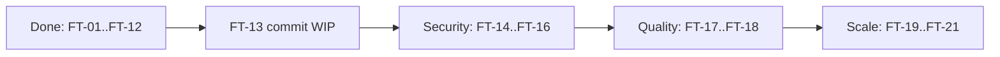

# Feature Ticket Document (Draft)

Priority: P0 must have, P1 should have, P2 nice to have. Size: S (≤1 day), M (2–3 days), L (a week+).

## 1. Ticket flow



## 2. Built (for the record)

| ID | Feature | Status |
|---|---|---|
| FT-01 | Multi-model units with isolation | Done |
| FT-02 | Safe model/dataset intake (hash, whitelist, size limit) | Done |
| FT-03 | Adapters: sklearn, XGBoost, LightGBM, CatBoost | Done (last two uncommitted) |
| FT-04 | Task metrics: binary, multiclass, regression | Done |
| FT-05 | 5-pillar health + drift with expected baselines | Done |
| FT-06 | Diagnosis + strategy selector | Done |
| FT-07 | Refinement (candidates) | Done |
| FT-08 | 7 safety gates | Done |
| FT-09 | Promotion modes + rollback + audit log | Done |
| FT-10 | Alerts (acknowledge / resolve) | Done |
| FT-11 | First-load sandbox (child process) | Done, uncommitted |
| FT-12 | Fleet UI, guided demo, inference sandbox | Done |

## 3. Open tickets

| ID | Title | Pri | Size | Acceptance criteria |
|---|---|:-:|:-:|---|
| FT-13 | Review and commit uncommitted work | P0 | S | All tests pass; docs updated; commits split by topic; `IntakeView` removal checked |
| FT-14 | Users and roles | P0 | L | Login; roles Viewer/Engineer/Approver/Admin; 403 for blocked actions; tests per role |
| FT-15 | Real actor in audit log | P0 | S | Every audit row holds the real user name, not "USER" |
| FT-16 | Frontend sends auth token | P0 | S | UI works with `MODEL_HEALTH_API_KEY` set; 401 shows a clear message |
| FT-17 | Pytest suite + test database | P1 | M | Scripts moved to `pytest`; tests never touch the dev DB; one command runs all |
| FT-18 | Lock down demo routes | P1 | S | `/api/demo/*` disabled unless `DEMO_MODE=1` |
| FT-19 | Background job queue for refinement | P1 | L | Refine returns a job id at once; UI polls; API not blocked |
| FT-20 | Shared rate limiter | P2 | S | Limits hold across several server processes |
| FT-21 | Container sandbox for model load | P2 | L | First load runs with no network and low rights; malicious test pickle cannot write files |
| FT-22 | Split large React components | P2 | M | No component above ~500 lines; no behaviour change |
| FT-23 | Frontend tests | P2 | M | Tests for upload, promote, rollback flows |
| FT-24 | Research CSV export in UI | P2 | S | Button downloads output of `export_research_dataset.py` |
| FT-25 | Full ranking metrics (NDCG, MAP) | P2 | M | Extends `tasks/ranking.py` beyond Precision@K |
| FT-26 | Trim `ARCHITECTURE.md` | P2 | S | Matches code; links to these short docs |

## 4. Ticket template

```
ID / Title:
Why (one sentence):
What changes:
Acceptance criteria (testable):
Out of scope:
Depends on:
```
