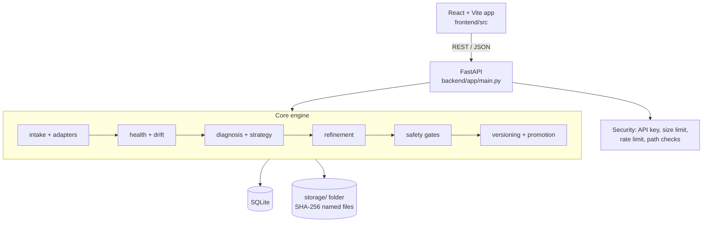
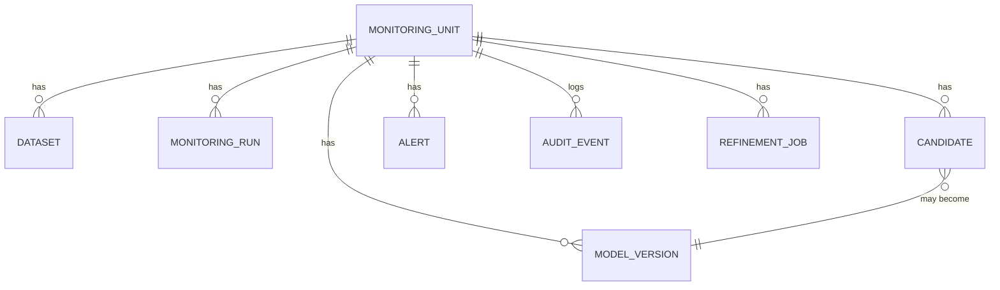

# Technical Requirements Document (Draft)

## 1. Architecture

Modular monolith: one backend process, one database file, one storage folder.

## 2. Modules

| Area | Files | Job |
|---|---|---|
| API | `main.py` | ~50 routes, error handlers |
| Storage | `artifact_storage.py`, `intake.py`, `sandbox.py` | Hash, save, first-load check |
| Models | `adapters/*` | One adapter per framework, chosen by `detector.py` |
| Tasks | `tasks/*` | Metrics per task type |
| Health | `health.py`, `health_status.py`, `drift.py`, `prediction_drift.py`, `data_quality.py`, `schema_checker.py` | 5-pillar score |
| Fixing | `diagnosis.py`, `strategy_selector.py`, `refinement.py`, `retraining.py` | Cause, then targeted fix |
| Safety | `safety_gates.py`, `promotion.py`, `versioning.py` | Gates, promote, rollback |
| Data | `database.py` | Tables and queries |

## 3. Main data

Table names are indicative; check `database.py` for exact columns.

## 4. Key technical rules

- **Drift:** KS-test (numeric) and TVD (categorical); no external drift library.
- **Diagnosis to fix:** Unexpected drift → data refresh. Decay → bounded random search. Imbalance → class balancing. Missing values → imputation. Constant columns → pruning. Output shift → calibration.
- **7 gates:** integrity, reload, compatibility, dry-run, absolute floor, improvement ≥ +0.005, no secondary metric drop worse than −0.02.
- **Modes:** AUTO promotes; ASSISTED stages; MANUAL advises.
- **Storage:** file name = SHA-256, so duplicates are stored once.
- **Errors:** custom exceptions; no stack traces to clients.

## 5. Non-functional targets

| Topic | Target |
|---|---|
| Upload limit | 50 MB (`MAX_UPLOAD_SIZE_MB`) |
| Rate limit | Intake 30/min, refine 10/min per IP |
| First-load timeout | 30 s |
| Isolation | Failure in one unit must not change another |
| Tests | 27 scripts pass; move to `pytest` with a separate test DB |

## 6. Config

`MODEL_HEALTH_API_KEY`, `MAX_UPLOAD_SIZE_MB`, `ALLOWED_ORIGINS`.

## 7. Technical debt

1. Tests share the dev DB and are not pytest.
2. In-memory rate limiter breaks with more than one server process.
3. Refinement runs inside the API process (no job queue).
4. SQLite + local disk = single server.
5. `ARCHITECTURE.md` is long and partly out of date on uncommitted work.
